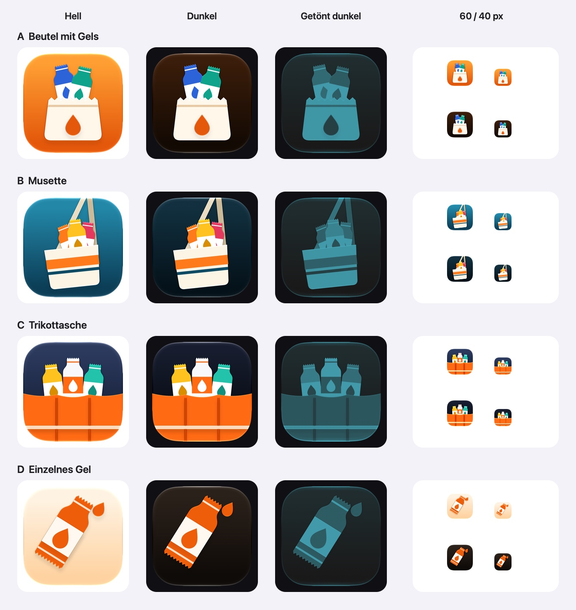

# Entwürfe für das neue App-Icon

Noch nichts davon ist im Asset-Katalog. Dort kommt erst der gewählte Entwurf hin.



| | Entwurf | Idee | Stärke | Schwäche |
|---|---|---|---|---|
| A | [Beutel mit Gels](a-beutel/tafel.jpg) | Tüte mit gezacktem Rand, zwei Gels schauen heraus | Trifft „Tüte mit Gel“, klare Silhouette, Orange wie die App-Akzentfarbe | Gels werden unter 60 px zu Farbflecken |
| B | [Musette](b-musette/tafel.jpg) | Verpflegungsbeutel aus dem Radsport, schräg am Gurt | Eindeutig Radsport | Am meisten Details, klein und getönt am unruhigsten |
| C | [Trikottasche](c-trikottasche/tafel.jpg) | Rückentaschen mit drei Gels | Farbig, zeigt „Vorrat“ | Keine Tüte; getönt wenig Kontrast |
| D | [Einzelnes Gel](d-einzelgel/tafel.jpg) | Ein Gel mit Tropfen | Am besten lesbar in 40 px | Kein Beutel; kann als Tube oder Flasche gelesen werden |

**Empfehlung: A.**

## Aufbau
Je Entwurf liegt unter `<entwurf>/CarbStock.icon` ein Icon-Composer-Paket mit SVG-Ebenen: Verlauf für hell und dunkel,
eigene Graustufen für „getönt“. Licht, Schatten und Maske ergänzt das System. Keine Schrift, keine Rasterbilder,
keine fremden Marken.

## Neu erzeugen (braucht Xcode, keinen Simulator)
```sh
python3 -I design/icon/erzeugen.py   # SVG, icon.json, Renderings mit Apples ictool
swift design/icon/tafeln.swift       # Tafeln
python3 -I design/icon/pruefen.py    # Prüfung
```
Die Tafeln zeigen echte `ictool`-Renderings; die getönten mit einem blaugrünen Beispielton, auf dem Gerät wählt man ihn selbst.
Die Homescreen-Ausschnitte sind nachgestellt (neutrale Platzhalter-Symbole).
